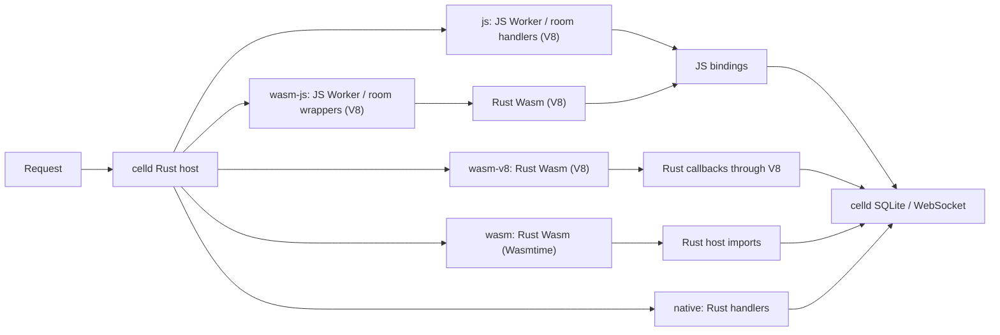

# celld-campfire-bench

A reproducible comparison of **JavaScript, TypeScript compiled to Wasm with scriptc, Rust Wasm, and native Rust** running the same chat workload inside [celld](https://github.com/denoland/celld). A stateless Worker routes requests to one Durable Object per chat room; each object stores messages in SQLite.

**Celld itself is a native Rust executable in every mode. The Wasm variants compile application code to Wasm.**

<!-- benchmark:start -->
## Results

Apple M4 Pro, 48 GiB RAM, macOS 26.5.2 arm64 · 2026-10-19. Medians of three 5-second trials.

### Server-rendered HTML (without in-memory page caching): 32 simultaneous clients

Each request authenticates a user, checks room membership, and renders the latest 50 messages. Database and operating-system caches remain active.

| Application runtime | Total requests/s | CPU use (%; 100% = 1 core) | CPU time/request (µs) | Peak process memory (MiB) | p99 response time (ms) |
| --- | ---: | ---: | ---: | ---: | ---: |
| JavaScript / V8 (baseline) | **2,594 (1.00×)** | 113.5 (1.00×) | 437.9 (1.00×) | 117.0 (1.00×) | 18.55 (1.00×) |
| Rust Wasm / V8 + JS bindings | **2,367 (0.91×)** | 117.4 (1.03×) | 499.2 (1.14×) | 119.6 (1.02×) | 20.72 (1.12×) |
| Rust Wasm / V8 + direct host calls | **7,625 (2.94×)** | 129.7 (1.14×) | 169.8 (0.39×) | 65.3 (0.56×) | 5.96 (0.32×) |
| Rust Wasm / Wasmtime + direct host calls | **7,918 (3.05×)** | 130.7 (1.15×) | 164.4 (0.38×) | 52.0 (0.44×) | 5.73 (0.31×) |
| TypeScript → scriptc Wasm / Wasmtime | **1,594 (0.61×)** | 104.7 (0.92×) | 654.1 (1.49×) | 65.5 (0.56×) | 38.48 (2.07×) |
| Native Rust | **10,727 (4.14×)** | 138.6 (1.22×) | 129.1 (0.29×) | 45.1 (0.39×) | 4.44 (0.24×) |

p99 response time: 99% of requests in a trial finished within this time.

### HTTP chat throughput (total requests/s): 32 simultaneous clients

| Request | JavaScript / V8 (baseline) | Rust Wasm / V8 + JS bindings | Rust Wasm / V8 + direct host calls | Rust Wasm / Wasmtime + direct host calls | TypeScript → scriptc Wasm / Wasmtime | Native Rust |
| --- | ---: | ---: | ---: | ---: | ---: | ---: |
| Read messages as JSON (no response cache) | 3,105 (1.00×) | 2,553 (0.82×) | 10,693 (3.44×) | 10,440 (3.36×) | 5,161 (1.66×) | 13,710 (4.42×) |
| Server-rendered HTML (with in-memory page caching) | 4,878 (1.00×) | 4,562 (0.94×) | 22,599 (4.63×) | 23,031 (4.72×) | 14,470 (2.97×) | 26,337 (5.40×) |
| Post a message; reply after saving it | 443 (1.00×) | 448 (1.01×) | 411 (0.93×) | 427 (0.96×) | 410 (0.92×) | 443 (1.00×) |

### WebSocket chat throughput (total messages/s)

Each room has one sender plus the receiving connections below. The sender waits for storage, broadcast, and every participant's HTTP read confirmation before sending the next message.

| Rooms and receiving connections | JavaScript / V8 (baseline) | Rust Wasm / V8 + JS bindings | Rust Wasm / V8 + direct host calls | Rust Wasm / Wasmtime + direct host calls | TypeScript → scriptc Wasm / Wasmtime | Native Rust |
| --- | ---: | ---: | ---: | ---: | ---: | ---: |
| 1 room, 32 receiving connections | 39 (1.00×) | 39 (1.00×) | 43 (1.11×) | 43 (1.10×) | 44 (1.14×) | 43 (1.12×) |
| 5 rooms, 8 receiving connections per room | 89 (1.00×) | 87 (0.97×) | 88 (0.99×) | 80 (0.90×) | 86 (0.97×) | 84 (0.95×) |

### Process startup and the Wasm compilation cache

Apple M4 Pro, 48 GiB RAM, macOS 26.5.2 arm64. Medians of 10 fresh processes per row, starting from the same room data. The cached Wasmtime row loads machine code saved before timing. Filesystem caches stay warm.

| Application runtime | Start → first room response (ms) | CPU time to first room response (ms) | Process memory after first room response (MiB) |
| --- | ---: | ---: | ---: |
| JavaScript / V8 (baseline) | 290.72 (1.00×) | 271.70 (1.00×) | 39.4 (1.00×) |
| Rust Wasm / V8 + JS bindings | 308.10 (1.06×) | 287.06 (1.06×) | 42.2 (1.07×) |
| Rust Wasm / V8 + direct host calls | 268.21 (0.92×) | 244.77 (0.90×) | 31.0 (0.79×) |
| Rust Wasm / Wasmtime: compile at startup | 334.06 (1.15×) | 306.42 (1.13×) | 31.2 (0.79×) |
| Rust Wasm / Wasmtime: reuse compiled module | 269.19 (0.93×) | 241.32 (0.89×) | 28.1 (0.71×) |
| TypeScript → scriptc Wasm / Wasmtime: compile at startup | 442.62 (1.52×) | 406.71 (1.50×) | 42.9 (1.09×) |
| Native Rust | 270.50 (0.93×) | 240.40 (0.88×) | 25.1 (0.64×) |

Wasm module compilation/loading: **69.14 ms → 1.05 ms** when reusing compiled code. All 10 cached trials hit the cache. Load tests exclude startup and compilation. [Raw data](results/2026-10-19/compile-cache/cold-cache-results.json).

[Complete report](results/2026-10-19/REPORT.md) · Raw data: [load tests](results/2026-10-19/results.json), [startup](results/2026-10-19/cold-results.json), [validation](results/2026-10-19/validation.json).
<!-- benchmark:end -->

<!-- workerd-benchmark:start -->
### workerd: server-rendered HTML (without in-memory page caching), 32 simultaneous clients

The same chat workload on workerd 2026-10-19, with one shared release build and SQLite seed. Apple M4 Pro, 48 GiB RAM · 2026-10-21. Medians of 3 5-second trials; ratios use this workerd JS baseline.

| Application runtime | Total requests/s | CPU use (%; 100% = 1 core) | CPU time/operation (µs) | Peak process memory (MiB) | p99 response time (ms) |
| --- | ---: | ---: | ---: | ---: | ---: |
| JavaScript / V8 (baseline) | 4,289 (1.00×) | 101.5 (1.00×) | 236.7 (1.00×) | 177.0 (1.00×) | 12.26 (1.00×) |
| Rust Wasm / V8 + JS bindings | 3,921 (0.91×) | 101.7 (1.00×) | 259.6 (1.10×) | 205.2 (1.16×) | 16.96 (1.38×) |
| Rust Wasm / V8 + direct C++ host calls (prototype) | 8,491 (1.98×) | 99.9 (0.98×) | 117.7 (0.50×) | 59.5 (0.34×) | 4.73 (0.39×) |

The direct path is a patched workerd prototype: HTTP → V8 Wasm → C++ host functions → workerd DO storage and WebSockets. It executes no JS application or binding callback. [Complete report and raw data](results/2026-10-21-workerd/REPORT.md) · [Reproduce](experiments/workerd/README.md).
<!-- workerd-benchmark:end -->

<!-- basecamp-benchmark:start -->
### Original Basecamp Rust application

The unmodified Basecamp application runs with 32 clients in the same session. Ratios use workerd JS for the corresponding request. The original renders 40 rich-text messages per page; the Workers chat renders 50 plain-text messages. SQL, caching, and write durability also differ, so these are whole-application references.

| Original application operation | Total requests/s | CPU use (%; 100% = 1 core) | CPU time/request (µs) | Peak process memory (MiB) | p99 response time (ms) | Response size (KiB) |
| --- | ---: | ---: | ---: | ---: | ---: | ---: |
| Messages HTML; response and fragment caches disabled | 277 (0.06×) | 99.8 (0.98×) | 3,607.3 (15.24×) | 45.6 (0.26×) | 183.33 (14.96×) | 385.0 |
| Messages HTML; original response and fragment caches enabled | 13,391 (1.23×) | 99.6 (0.98×) | 74.4 (0.80×) | 117.8 (0.35×) | 4.07 (0.30×) | 385.0 |
| Post a message; original caches enabled | 3,099 (0.49×) | 137.1 (1.49×) | 442.8 (3.04×) | 133.2 (0.57×) | 19.39 (0.71×) | 9.8 |

[Original application report and raw data](results/2026-10-21-basecamp/REPORT.md) · [Reproduce](experiments/basecamp/README.md).
<!-- basecamp-benchmark:end -->

## Request and binding paths

| Mode | Application code | SQL and WebSocket access |
| --- | --- | --- |
| `js` | JavaScript in V8 | JS Worker and Durable Object APIs |
| `wasm-js` — **current standard Wasm model in celld / Cloudflare Workers** | Rust Wasm in V8 | [JS Worker entry and JS bindings](application/wasm-worker.js) |
| `wasm-v8` | The same Wasm module in V8 | Rust callbacks through V8; no JS source execution |
| `wasm` | The same Wasm module in Wasmtime 49 | Rust host imports; no JS execution |
| `scriptc-wasm` | TypeScript compiled to Wasm in Wasmtime 49 | Rust host imports; no JS execution |
| `native` | The same Rust source compiled natively | Direct Rust calls |

`wasm-js` measures a standard Wasm Worker on celld: JS Worker → Rust Wasm → JS bindings. The three Rust Wasm modes use the same module. SQLite runs outside Wasm in every mode. These are local celld measurements; Cloudflare Workers is an architecture reference.

## Reproduce

[Build, run the benchmarks, or open the chat app](REPRODUCE.md).

## What the numbers measure

CPU and memory cover the entire celld server process, including runtime state, application caches, SQLite, and network buffers. Helper threads can make CPU use exceed one core.

The two V8 Wasm modes share the engine, module, business logic, and binary data format. Their difference includes the JS Worker entry, SQL cursor wrappers, conversion of SQL rows, and per-socket sends. These are measurements of the complete paths on celld.

The test uses one node and local persistence. Native Rust runs as trusted code. The direct Wasm prototype implements this application's HTTP, SQL, object calls, and WebSocket operations; tenant CPU enforcement and the complete asynchronous Workers API are outside its scope.

## Repository files

| Path | Contents |
| --- | --- |
| `application/` | JS chat implementation, JS-to-Wasm adapter, Worker configuration, and browser UI |
| `app/` | Rust chat logic, SQL, and database schema |
| `guest/` | Rust Wasm entry points and imports for host functions |
| `host.rs` | Rust host adapters for native Rust, Wasmtime, direct V8 Wasm, and scriptc |
| `load/` | HTTP and WebSocket load generators that check responses |
| `bench/` | Build, data preparation, measurement, and report scripts |
| `patches/celld.patch` | Integration with the pinned celld source and locked dependencies |
| `experiments/scriptc/` | TypeScript-to-Wasm chat application, Rust imports, and compiler setup |
| `experiments/workerd/` | Workerd native Wasm host, build and measurement scripts, and reproduction instructions |
| `experiments/basecamp/` | Build and measurement scripts for Basecamp's unmodified Rust application |
| `results/` | Recorded measurements, measured source files, and full reports |

## References

[Basecamp Campfire](https://github.com/basecamp/once-campfire/tree/edbc779f4dfc9b26c36310881711ddc976a9dfc8) supplies the chat-application reference. [Campfire in Rust](https://github.com/basecamp/once-campfire-rust/tree/6dae2fd3c1a2dce61ca11beb731bcce2b42b67ad) supplies the original native application. The celld and workerd tables compare the Workers-style chat workload; the original Basecamp application is measured separately. Basecamp's published results use different workloads and hardware.

Runtime base: [celld v0.6.2](https://github.com/denoland/celld/tree/90b43017241f81189453d326d05948f388b34652). License: [Apache-2.0](LICENSE); see [NOTICE](NOTICE) for retained upstream notices.
