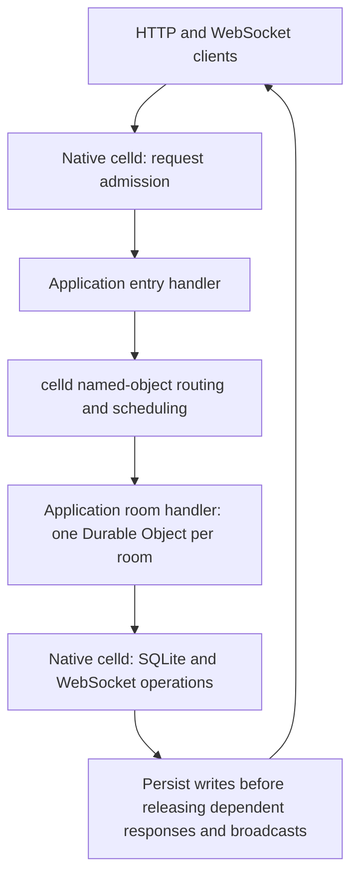

# celld-campfire-bench

A reproducible comparison of **JavaScript, Rust Wasm, and native Rust** running the same chat workload inside [celld](https://github.com/denoland/celld). The application uses a stateless Worker entry handler and one Durable Object per room. This repository contains the application, runtime adapter, build patch, validated load clients, and recorded measurements.

The experiment asks how application execution changes throughput, CPU use, memory, and startup while keeping celld's object routing, scheduling, storage, and durability mechanisms shared. **Celld itself is a native Rust executable in every mode. Only the Rust application's Wasm variants are compiled to Wasm.**

<!-- benchmark:start -->
## Results

Recorded on 2026-10-15: Apple M4 Pro, 14 logical CPUs, 48 GiB RAM, macOS 26.5.2 arm64. Each HTTP case runs for five seconds at 1, 32, and 128 concurrent clients, with three rounds and a fresh server process per trial. The tables show medians.

Each client waits for a complete response before sending its next request; 32 concurrent clients allow up to 32 requests in flight. Each measurement shows **absolute value (ratio to JS)** for the same workload and client count. JS is **1.00×**; a memory ratio of **0.45×** means 45% of JS's memory. Ratios use the unrounded medians. Higher throughput is better; lower CPU time, memory, latency, and startup time are better.

### Server-rendered HTML (without in-memory page caching): 32 concurrent clients

Each request authenticates a user, checks room membership, queries the latest 50 messages, and renders HTML. Only the generated full-page cache is disabled; database and operating-system caches remain active.

| Application execution | Requests/s | CPU % | CPU µs/request | Process memory MiB | p99 ms |
| --- | ---: | ---: | ---: | ---: | ---: |
| JavaScript / V8 | **2,573 (1.00×)** | 113.1 (1.00×) | 439.8 (1.00×) | 113.7 (1.00×) | 18.94 (1.00×) |
| Rust Wasm / Wasmtime | **8,066 (3.14×)** | 128.2 (1.13×) | 159.0 (0.36×) | 51.0 (0.45×) | 5.71 (0.30×) |
| Native Rust | **10,771 (4.19×)** | 134.4 (1.19×) | 124.8 (0.28×) | 46.2 (0.41×) | 4.45 (0.23×) |

For this read, Rust Wasm delivers **3.14× JavaScript's throughput**, consumes **64% less CPU time per request**, and uses **55% less process memory**.

CPU 100% means one fully occupied core; helper threads can take the total above 100%. The CPU % ratio measures total CPU use at each engine's achieved throughput. CPU time per request compares efficiency at equal work. Memory is the whole server process: the median of the sampled peak physical footprints, in MiB.

### Other application paths

| Workload | JavaScript / V8 | Rust Wasm / Wasmtime | Native Rust |
| --- | ---: | ---: | ---: |
| Uncached JSON, 32 clients (requests/s) | 3,215 (1.00×) | 10,988 (3.42×) | 14,258 (4.44×) |
| Cached HTML, 32 clients (requests/s) | 5,051 (1.00×) | 25,808 (5.11×) | 29,312 (5.80×) |
| Durable posts, 32 clients (requests/s) | 356 (1.00×) | 377 (1.06×) | 368 (1.03×) |
| WebSocket: 1 room, 32 listeners (messages/s) | 40 (1.00×) | 42 (1.06×) | 42 (1.04×) |
| WebSocket: 5 rooms, 8 listeners each (messages/s) | 76 (1.00×) | 75 (0.98×) | 76 (1.00×) |

A WebSocket message includes persistence, broadcast to every participant, and each participant’s HTTP read acknowledgment. Durable posts and these full message rounds have similar throughput across the three implementations: they wait for the same persistence and response/broadcast release mechanism.

### Process startup

| Application execution | Process launch → first room page, ms | Process memory after first page, MiB |
| --- | ---: | ---: |
| JavaScript / V8 | 288.80 (1.00×) | 39.2 (1.00×) |
| Rust Wasm / Wasmtime | 331.33 (1.15×) | 30.7 (0.78×) |
| Native Rust | 261.19 (0.90×) | 24.6 (0.63×) |

Startup values are medians of ten fresh processes. They include service startup, object activation, and the first room response. Filesystem caches stay warm; Wasmtime compiles the module inside each process and uses no cross-process AOT cache.

The [complete report](results/2026-10-15/REPORT.md) includes every concurrency, CPU and physical-memory measurements, latency, trial ranges, write rates, correctness checks, and the auxiliary V8 Wasm comparison. Raw data also includes RSS: [pressure](results/2026-10-15/results.json), [startup](results/2026-10-15/cold-results.json), [validation](results/2026-10-15/validation.json).
<!-- benchmark:end -->

## What runs

| Mode | Application execution | SQL and WebSocket calls |
| --- | --- | --- |
| `js` | JavaScript in V8 | Existing Workers and Durable Object APIs |
| `wasm` | Rust compiled to Wasm, executed by embedded Wasmtime 49 | Typed Wasm imports call native Rust functions; request execution and these calls use no JS function/value interface |
| `native` | The same Rust business source compiled into celld | Direct Rust trait calls; a trusted-code reference |

The auxiliary `wasm-v8` mode executes the same Wasm module in V8. It executes no JS application source, but its host calls use V8's native function/value interface. The full reproduction command includes this recorded auxiliary comparison; the README tables focus on the three primary modes.



The selected engine executes both application handlers. JavaScript has its own implementation; all Rust modes share [`app/src/lib.rs`](app/src/lib.rs), SQL, schema, data, and cache policy. The Rust adapter in [`host.rs`](host.rs) submits real celld object calls and retains celld's ownership, activation, per-cell scheduling, SQLite cursors, write/observed positions, WebSocket registry, LTX persistence, and output gates.

The application implements demo login, membership checks, 50 rooms with 1,000 seeded messages each, HTML/JSON history, posting, unread counts, a page cache, and live WebSocket broadcasts. Messages include Chinese, emoji, URLs, newlines, and HTML characters. The scope is this runnable Workers-style chat workload. Full Campfire database/cookie compatibility, rich text, uploads, search, Web Push, and bot integrations are outside it.

## Reproduce

The resource runner requires **macOS**, Git, Xcode Command Line Tools, Python 3.11+, Rustup, and [Vite+](https://viteplus.dev/). `rust-toolchain.toml` selects Rust 1.96.0 and the Wasm target. The recorded results come from Apple Silicon. Reading and verifying the recorded reports needs only Python 3.11+ and works on other operating systems.

From the repository root:

```sh
vp install --frozen-lockfile
python3 bench/build.py
python3 bench/run.py --phase all --seconds 5 --rounds 3 --concurrencies 1,32,128
python3 bench/report.py .runs/current > .runs/current/REPORT.md
python3 bench/report.py .runs/current --check
```

The build installs the pinned Rust toolchain and Wasm target through Rustup, fetches the exact celld revision in [`celld.json`](celld.json), applies [`patches/celld.patch`](patches/celld.patch), copies the application and adapter into that generated checkout, and builds the host, Wasm module, and two pressure clients with locked dependencies. Generated source and build outputs live under `.build/`. The patch adds the application's direct Rust/Wasm execution path to celld. All modes use the same patched executable; JS executes through celld's existing Workers APIs.

The full suite takes tens of minutes on the recorded machine, in addition to build time. It runs the four modes sequentially, rotating their order between rounds. Ports **19878** and **19879** must be free. The runner owns and stops the processes it launches. Logs, seed snapshots, disposable runtime data, fresh measurement JSON, and captured source files live under `.runs/current/`; recorded results live under `results/2026-10-15/`.

The phases can also run separately:

```sh
python3 bench/run.py --phase prepare
python3 bench/run.py --phase validate
python3 bench/run.py --phase bench --seconds 5 --rounds 3 --concurrencies 1,32,128
python3 bench/run.py --phase cold
```

`prepare` creates and audits the persistent seed. `validate` checks full response bytes, invalid input and permissions, cache invalidation, large/escaped messages, ordered WebSocket broadcasts, unread changes, and restart recovery after deleting the local runtime directory. Every pressure trial restores the same seed and ends with an audit of all 50 room databases. `cold` measures ten fresh processes per engine. Build-input and binary hashes are checked before running a phase.

To check the published tables and captured source hashes, with no Rust build or package installation:

```sh
python3 bench/report.py --check
```

To regenerate the complete recorded report:

```sh
python3 bench/report.py > results/2026-10-15/REPORT.md
```

## Open the application

After building, start the JS mode:

```sh
CELLD_ESBUILD="$PWD/node_modules/.bin/esbuild" \
WORKERS_CHAT_ENGINE=js \
WORKERS_CHAT_WASM="$PWD/.build/guest-target/wasm32-unknown-unknown/release/workers_chat_guest.wasm" \
.build/host-target/release/celld dev application --port 19878 --no-watch
```

Open `http://127.0.0.1:19878/`. Demo users are 1 through 7; user N has password `password-N`. Select `wasm`, `native`, or `wasm-v8` through `WORKERS_CHAT_ENGINE` to open another implementation. Stop the process before switching. This command serves the interactive app; the benchmark runner sets the measured concurrency and runtime configuration.

## Reading the measurements

All modes use one Tokio executor thread, one stateless slot, celld's 32-cells-per-slot policy, and a per-cell in-flight limit of 256. Ownership, blocking I/O, and engine helper threads remain active. The process can use more than one CPU core. The persistence target is celld's SQLite-backed local object store on a single node.

The comparison measures complete application execution, including its adapters. JS uses SQL cursor wrappers and per-socket sends. The Rust adapters transfer typed SQL rows and expose a host broadcast operation. The resulting performance differences include application code, runtime bookkeeping, API design, data conversion, and generated machine code.

HTTP load clients verify complete read lengths and CRC32 values against an independent Python fixture, check write responses and contiguous versions, and reject reads older than writes acknowledged before dispatch. Database audits check every message, timestamp, user, unread count, version, and SQLite integrity. WebSocket clients verify every frame and read acknowledgment. The complete report describes timing windows, warmup, memory sampling, and the mixed writer's actual rate.

The recorded JSON retains the original metric records and SHA-256 digests. Its `source_snapshot` identifies 24 captured application, adapter, runtime, manifest, and lockfile sources. Its `recorded_only` map lists four measured binary digests and two original harness-module digests whose bytes are retained as hashes. The portable runner packages the workload and resource meter under `bench/`. Fresh runs capture their own sources and binary digests. Rebuilding produces new binaries and a new measurement dataset.

The native implementation is trusted code and supplies no sandbox for untrusted native programs. The Wasm adapters limit memory and storage scope; the prototype implements this application's buffered HTTP, SQL, object calls, and WebSocket operations. Tenant CPU interruption and the general asynchronous Workers API are outside its scope. These measurements cover one node and local persistence.

## Layout

| Path | Contents |
| --- | --- |
| `application/` | JS Worker, room Durable Object, Wrangler configuration, and browser UI |
| `app/` | Shared Rust business logic, SQL, and schema |
| `guest/` | Rust Wasm entry points and host imports |
| `host.rs` | Native Rust, Wasmtime, and V8 Wasm integration with celld |
| `load/` | Validated HTTP and WebSocket pressure clients |
| `bench/` | Build, fixture, resource meter, experiment runner, and report generator |
| `patches/celld.patch` | Runtime integration and locked dependencies for the pinned celld source |
| `results/2026-10-15/` | Recorded measurements, source snapshots, and complete report |

## References

[Basecamp Campfire](https://github.com/basecamp/once-campfire/tree/edbc779f4dfc9b26c36310881711ddc976a9dfc8) supplies the chat-application reference. [Campfire in Rust](https://github.com/basecamp/once-campfire-rust/tree/6dae2fd3c1a2dce61ca11beb731bcce2b42b67ad) illustrates a native implementation and reproducible app-level benchmarks. Their published results use different applications, workloads, and hardware from this repository. The numbers here compare only this celld application under the stated conditions.

Runtime base: [celld v0.6.2](https://github.com/denoland/celld/tree/90b43017241f81189453d326d05948f388b34652). License: [Apache-2.0](LICENSE); see [NOTICE](NOTICE) for retained upstream notices.
