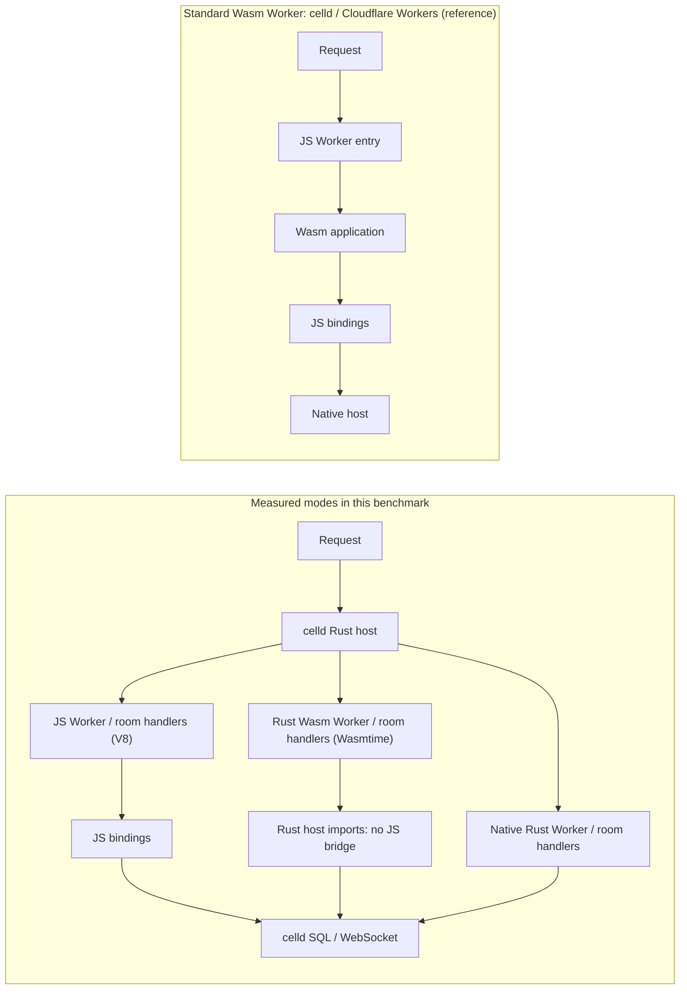

# celld-campfire-bench

A reproducible comparison of **JavaScript, Rust Wasm, and native Rust** running the same chat workload inside [celld](https://github.com/denoland/celld). The application uses a stateless Worker entry handler and one Durable Object per room.

**Celld itself is a native Rust executable in every mode. Only the Rust application's Wasm variants are compiled to Wasm.**

<!-- benchmark:start -->
## Results

Apple M4 Pro, 48 GiB RAM, macOS 26.5.2 arm64 · 2026-10-15. Medians of three 5-second trials.

### Server-rendered HTML (without in-memory page caching): 32 concurrent clients

Each request authenticates a user, checks membership, and renders the latest 50 messages. Database and operating-system caches remain active.

| Application execution | Requests/s | CPU % (100% = 1 core) | CPU µs/request | Peak process memory MiB | p99 ms |
| --- | ---: | ---: | ---: | ---: | ---: |
| JavaScript / V8 (baseline) | **2,573 (1.00×)** | 113.1 (1.00×) | 439.8 (1.00×) | 113.7 (1.00×) | 18.94 (1.00×) |
| Rust Wasm / Wasmtime | **8,066 (3.14×)** | 128.2 (1.13×) | 159.0 (0.36×) | 51.0 (0.45×) | 5.71 (0.30×) |
| Native Rust | **10,771 (4.19×)** | 134.4 (1.19×) | 124.8 (0.28×) | 46.2 (0.41×) | 4.45 (0.23×) |

### Other chat operations

| HTTP operation: requests/s, 32 concurrent clients | JavaScript / V8 (baseline) | Rust Wasm / Wasmtime | Native Rust |
| --- | ---: | ---: | ---: |
| Read messages as JSON (no response cache) | 3,215 (1.00×) | 10,988 (3.42×) | 14,258 (4.44×) |
| Read HTML with in-memory page caching | 5,051 (1.00×) | 25,808 (5.11×) | 29,312 (5.80×) |
| Post a message; reply after saving it | 356 (1.00×) | 377 (1.06×) | 368 (1.03×) |

Each WebSocket message is saved and broadcast; the producer waits for every participant's HTTP read acknowledgment.

| WebSocket setup: messages/s | JavaScript / V8 (baseline) | Rust Wasm / Wasmtime | Native Rust |
| --- | ---: | ---: | ---: |
| 1 room, 32 listeners | 40 (1.00×) | 42 (1.06×) | 42 (1.04×) |
| 5 rooms, 8 listeners each | 76 (1.00×) | 75 (0.98×) | 76 (1.00×) |

### Process startup with a compilation cache

Apple M4 Pro, 48 GiB RAM, `macOS-26.5.2-arm64-arm-64bit-Mach-O`. Medians of 10 fresh processes per configuration. The executable and seed are shared; both Wasm modes use the same module. Wasmtime's compilation cache is populated before timing; filesystem caches stay warm.

| Application execution | Launch → first room page, ms | CPU time through first page, ms | Process memory after page, MiB |
| --- | ---: | ---: | ---: |
| JavaScript / V8 (baseline) | 284.46 (1.00×) | 278.90 (1.00×) | 39.9 (1.00×) |
| Rust Wasm / Wasmtime: cache disabled | 330.20 (1.16×) | 311.40 (1.12×) | 31.1 (0.78×) |
| Rust Wasm / Wasmtime: cache hit | 259.60 (0.91×) | 243.54 (0.87×) | 28.5 (0.72×) |
| Native Rust | 259.55 (0.91×) | 242.57 (0.87×) | 25.1 (0.63×) |

Wasm module compile/load: **66.52 ms → 1.02 ms** on a cache hit. All 10 cached trials hit the cache. Throughput tests exclude compilation through warmup. [Raw data](results/2026-10-15/compile-cache/cold-cache-results.json).

[Complete report](results/2026-10-15/REPORT.md) · Raw data: [throughput](results/2026-10-15/results.json), [startup](results/2026-10-15/cold-results.json), [validation](results/2026-10-15/validation.json).
<!-- benchmark:end -->

## What runs

| Mode | Application execution | SQL and WebSocket calls |
| --- | --- | --- |
| `js` | JavaScript in V8 | Existing Workers and Durable Object APIs |
| `wasm` | Rust compiled to Wasm, executed by Wasmtime 49 | Wasm imports → native Rust bindings; no JS bridge |
| `native` | The same Rust business source compiled into celld | Direct Rust trait calls; a trusted-code reference |

The auxiliary `wasm-v8` mode hosts Wasm in V8 and exposes bindings through V8's native callbacks; its measurements are in the [complete report](results/2026-10-15/REPORT.md).



## Reproduce

[Build and run the benchmarks](REPRODUCE.md).

## Open the application

After building, start the JS mode:

```sh
CELLD_ESBUILD="$PWD/node_modules/.bin/esbuild" \
WORKERS_CHAT_ENGINE=js \
WORKERS_CHAT_WASM="$PWD/.build/guest-target/wasm32-unknown-unknown/release/workers_chat_guest.wasm" \
.build/host-target/release/celld dev application --port 19878 --no-watch
```

Open `http://127.0.0.1:19878/`. Demo users are 1 through 7; user N has password `password-N`. Select `wasm`, `native`, or `wasm-v8` through `WORKERS_CHAT_ENGINE` to open another implementation. Stop the process before switching. This command serves the interactive app; the benchmark runner sets the measured concurrency and runtime configuration.

## Reading the measurements

All modes use one Tokio executor thread, one stateless slot, celld's 32-cells-per-slot policy, and a per-cell in-flight limit of 256. Ownership, blocking I/O, and engine helper threads remain active. The process can use more than one CPU core. The persistence target is celld's SQLite-backed local object store on a single node.

The comparison measures complete application execution, including its adapters. JS uses SQL cursor wrappers and per-socket sends. The Rust adapters transfer typed SQL rows and expose a host broadcast operation. The resulting performance differences include application code, runtime bookkeeping, API design, data conversion, and generated machine code.

Load clients verify response contents, message ordering, and WebSocket deliveries. Measurement methods and validation details are in the [complete report](results/2026-10-15/REPORT.md#measurement).

Raw measurements include binary hashes and source snapshots. The compilation-cache comparison has its own build and snapshot under `results/2026-10-15/compile-cache/`.

The native implementation is trusted code and supplies no sandbox for untrusted native programs. The Wasm adapters limit memory and storage scope; the prototype implements this application's buffered HTTP, SQL, object calls, and WebSocket operations. Tenant CPU interruption and the general asynchronous Workers API are outside its scope. These measurements cover one node and local persistence.

## Layout

| Path | Contents |
| --- | --- |
| `application/` | JS Worker, room Durable Object, Wrangler configuration, and browser UI |
| `app/` | Shared Rust business logic, SQL, and schema |
| `guest/` | Rust Wasm entry points and host imports |
| `host.rs` | Native Rust, Wasmtime, and V8 Wasm integration with celld |
| `load/` | Validated HTTP and WebSocket pressure clients |
| `bench/` | Build, fixture, resource meter, experiment runner, and report generator |
| `patches/celld.patch` | Runtime integration and locked dependencies for the pinned celld source |
| `results/2026-10-15/` | Recorded measurements, source snapshots, and complete report |

## References

[Basecamp Campfire](https://github.com/basecamp/once-campfire/tree/edbc779f4dfc9b26c36310881711ddc976a9dfc8) supplies the chat-application reference. [Campfire in Rust](https://github.com/basecamp/once-campfire-rust/tree/6dae2fd3c1a2dce61ca11beb731bcce2b42b67ad) illustrates a native implementation and reproducible app-level benchmarks. Their published results use different applications, workloads, and hardware from this repository. The numbers here compare only this celld application under the stated conditions.

Runtime base: [celld v0.6.2](https://github.com/denoland/celld/tree/90b43017241f81189453d326d05948f388b34652). License: [Apache-2.0](LICENSE); see [NOTICE](NOTICE) for retained upstream notices.
