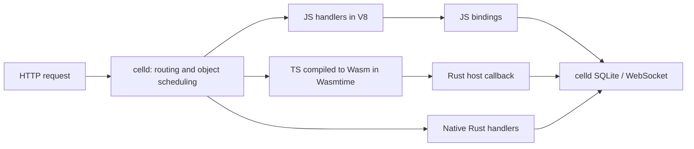

# TypeScript compiled by scriptc, running on celld

[scriptc](https://github.com/vercel-labs/scriptc) 0.3.6 compiles the chat application's TypeScript Worker and Durable Object handlers to Wasm. The compiled handlers execute inside celld and call its SQLite and WebSocket functions through Rust, with no JavaScript execution in the request or binding path.

The Wasm path improves JSON and cached-page throughput and reduces process memory; rendering HTML per request remains slower than V8. Native Rust leads the read workloads, while durable writes and end-to-end WebSocket chat have similar throughput across modes.

<!-- results:start -->
## Results

Apple M4 Pro, 48 GiB RAM, macOS 26.5.2 arm64 · 2026-10-19. Medians of three 3-second trials, 32 simultaneous clients. All ratios use JavaScript as the baseline.

### Server-rendered HTML (without in-memory page caching)

| Application runtime | Requests/s | CPU use (%; 100% = 1 core) | CPU µs/request | Peak process memory (MiB) |
| --- | ---: | ---: | ---: | ---: |
| JavaScript / V8 | 2,488 (1.00×) | 114.3 (1.00×) | 459.5 (1.00×) | 111.5 (1.00×) |
| TypeScript → scriptc Wasm / Wasmtime | 1,635 (0.66×) | 106.8 (0.93×) | 655.6 (1.43×) | 64.6 (0.58×) |
| Native Rust | 10,595 (4.26×) | 138.9 (1.22×) | 131.1 (0.29×) | 44.8 (0.40×) |

### Read messages as JSON (no response cache)

| Application runtime | Requests/s | CPU use (%; 100% = 1 core) | CPU µs/request | Peak process memory (MiB) |
| --- | ---: | ---: | ---: | ---: |
| JavaScript / V8 | 3,050 (1.00×) | 116.1 (1.00×) | 380.9 (1.00×) | 109.7 (1.00×) |
| TypeScript → scriptc Wasm / Wasmtime | 5,199 (1.70×) | 120.3 (1.04×) | 233.0 (0.61×) | 67.0 (0.61×) |
| Native Rust | 13,224 (4.34×) | 148.8 (1.28×) | 112.2 (0.29×) | 46.2 (0.42×) |

CPU and memory cover the whole celld process. Each request queries SQLite and returns the latest 50 messages. Startup and module compilation precede load timing.

[All seven workloads, trial ranges, and raw measurements](results/celld/REPORT.md).
<!-- results:end -->

## Request and database access

| Mode | Request handling | Database and WebSocket calls |
| --- | --- | --- |
| JavaScript / V8 | JS Worker → room Durable Object | celld's JS bindings → Rust → SQLite / sockets |
| scriptc Wasm / Wasmtime | Compiled TS Worker → compiled TS room handler | Wasm import → Rust → SQLite / sockets |
| Native Rust | Rust Worker → Rust room handler | Direct Rust calls → SQLite / sockets |

The scriptc mode runs [`celld/app.ts`](celld/app.ts), a typed adaptation of [`application/worker.js`](../../application/worker.js). Requests, handler results, SQL arguments, and SQL rows cross the Wasm/Rust boundary as JSON. These conversions are measured. The JS baseline uses its existing SQL cursor wrappers; the Rust control uses direct Rust values. The numbers compare these complete implementations, including their adapters.

SQLite executes in celld's Rust host. Only the TypeScript application and scriptc's C runtime are compiled to Wasm; celld remains a native Rust executable. [`celld/host.rs`](celld/host.rs) implements the Wasm imports in Rust. This prototype extends celld with the scriptc entry points and host functions; standard celld / Cloudflare Wasm Workers enter through JS and use JS bindings.

All modes use celld's object ownership, per-object scheduling, SQLite cursors, persistence, output gates, and WebSocket registry. The Wasm implementation has separate linear memory and a 128 MiB memory limit per instance. This experiment implements the application's synchronous SQL and socket operations; it does not implement the complete asynchronous Workers API or tenant CPU enforcement.

## Reproduce

[Build and run the full application comparison](REPRODUCE.md).
